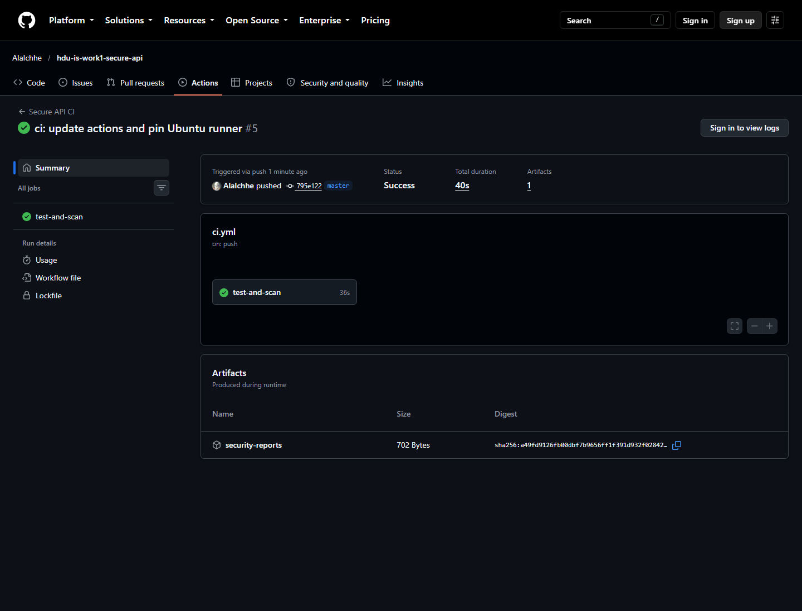

HDU IS Laboratory

<h1>Laboratory Work No. 1</h1>
<h2>Secure REST API Development with CI/CD and Real CVE Vulnerability Analysis</h2>

<table class="student-table">
<tr><td><strong>Variant</strong></td><td>Variant 1</td></tr>
<tr><td><strong>Student</strong></td><td>zhuhe</td></tr>
<tr><td><strong>HDU number</strong></td><td>23320116</td></tr>
<tr><td><strong>Date</strong></td><td>19 October 2026</td></tr>
</table>

# 1. Purpose

The purpose of this laboratory work is to build a small but complete secure
backend service and to study a real vulnerability through the full security
lifecycle. The work combines secure API design, password and token handling,
SQL injection and XSS defenses, automated security checks in CI/CD, controlled
vulnerability reproduction with Vulhub, root-cause analysis, remediation, and
regression testing.

The selected real vulnerability is CVE-2022-22947 in Spring Cloud Gateway
3.1.0. The vulnerable service was run locally in Docker, the SpEL injection was
reproduced against the lab target, and a fixed 3.1.1 build with a restricted
expression context was compiled and verified.

# 2. Executive Summary

The delivered project contains:

- a Flask REST API with three business endpoints and one health endpoint;
- SQLite persistence using parameterized SQL only;
- scrypt password hashing and 15-minute HS256 JSON Web Tokens;
- output encoding for all user-controlled text returned by the API;
- security headers on every response;
- nine automated API tests;
- a GitHub Actions workflow with pytest, Bandit SAST, pip-audit SCA,
  report artifacts, and a Docker build;
- a vulnerable Spring Cloud Gateway 3.1.0 environment that demonstrates
  unauthenticated SpEL injection through the Actuator API;
- a fixed Spring Cloud Gateway 3.1.1 build that blocks the injected expression
  while preserving health, route, and filter functionality.

The local security scans are clean after dependency remediation. During the
initial software composition analysis, pip-audit found 17 advisories in Flask
3.1.2 and PyJWT 2.10.1. Upgrading to Flask 3.1.3 and PyJWT 2.15.1 removed all
known findings.

The public repository is https://github.com/AlaIchhe/hdu-is-work1-secure-api.
The GitHub Actions workflow completed successfully in 40 seconds, including
the tests, both security scanners, and the Docker build. A verified run is
https://github.com/AlaIchhe/hdu-is-work1-secure-api/actions/runs/39229094367.

# 3. API Design and Functionality

The API is implemented in Python with Flask. SQLite is used as the storage
engine. The application factory creates the database tables on startup, and
the container entrypoint can seed two demonstration users and two posts.

| Method | Endpoint | Protection | Description |
|---|---|---|---|
| POST | /api/auth/login | Input validation, scrypt verification | Checks username and password and returns a JWT |
| GET | /api/data | Bearer JWT | Returns the protected post feed |
| POST | /api/posts | Bearer JWT, validation, output encoding | Creates a post for the authenticated user |
| GET | /health | None | Returns a small service health response |

The database contains a users table and a posts table with a foreign key from
posts to users. Passwords are represented only by salted scrypt strings.

The third endpoint selected for the assignment is POST /api/posts. It was
chosen because it exercises authentication, input validation, parameterized
insertion, ownership, and output encoding in one flow.

# 4. Implemented Security Measures

## 4.1 SQL injection prevention

All SQL statements use SQLite placeholders. No query is assembled from user
strings. The login query uses:

~~~python
connection.execute(
    "SELECT id, username, password_hash FROM users WHERE username = ?",
    (username,),
)
~~~

Post insertion uses the same pattern:

~~~python
connection.execute(
    "INSERT INTO posts (user_id, title, body) VALUES (?, ?, ?)",
    (current_user_id, title, body),
)
~~~

The test suite sends an authentication bypass string and a post body containing
DROP TABLE. Login is denied, the posts table remains present, and the malicious
text is stored as data rather than executed as SQL.

## 4.2 XSS prevention

All user-controlled strings returned by the API pass through:

~~~python
html.escape(value, quote=True)
~~~

This covers authors, titles, and post bodies. JSON is returned with the
application/json content type. The application also sends nosniff,
frame-denial, no-referrer, restrictive CSP, and no-store headers. Output
encoding is applied at the API boundary as required by the assignment, and the
CSP provides a second layer for any browser-rendered client.

The XSS test stores a script tag and an img event handler, then verifies that
the returned JSON contains HTML entities such as &lt;script&gt; and does not
contain executable script markup.

## 4.3 Authentication and password storage

Passwords are hashed with scrypt through Werkzeug. The chosen parameters are
N=32768, r=8, p=1 with a random 16-byte salt and a 64-byte derived key. The
plaintext password is never persisted.

Successful authentication produces a signed HS256 JWT. The token contains:

- subject and username;
- issued-at and not-before times;
- a short expiration time (15 minutes);
- issuer and audience;
- a random token identifier.

Token verification checks the signature, issuer, audience, required claims,
and time window. The fixed algorithm list prevents algorithm substitution.
Missing, malformed, expired, and tampered tokens produce a generic HTTP 401
response with a Bearer challenge.

The login path also verifies a dummy scrypt hash when the account does not
exist. This reduces obvious timing differences that could help an attacker
enumerate usernames.

## 4.4 Evidence of secure API behavior

<figure>

<figcaption>Figure 1. Health check, unauthenticated denial, login, JWT issuance, and protected data access.</figcaption>
</figure>

<figure>

<figcaption>Figure 2. SQL injection login rejection and HTML entity encoding of an XSS payload.</figcaption>
</figure>

<figure>

<figcaption>Figure 3. Nine automated API and security tests pass.</figcaption>
</figure>

# 5. CI/CD and Security Scanning

The workflow file is .github/workflows/ci.yml. It is triggered by every push and
every pull request. The job performs the following steps:

1. checks out the repository;
2. installs Python 3.12 and cached pip dependencies;
3. installs runtime and development requirements;
4. runs the complete pytest suite;
5. runs Bandit static analysis over app.py and secure_api;
6. runs pip-audit against the runtime requirements;
7. builds the Docker image;
8. uploads the JSON and text security reports as the security-reports
   workflow artifact.

Bandit analyzes Python source for common insecure patterns such as command
execution, unsafe deserialization, weak cryptography, and hard-coded secrets.
pip-audit checks the resolved dependency versions against public vulnerability
advisories.

The local run produced:

~~~text
Bandit: No issues identified.
pip-audit: No known vulnerabilities found.
~~~

The first SCA run found 17 advisories in Flask 3.1.2 and PyJWT 2.10.1. The
requirements were upgraded to Flask 3.1.3 and PyJWT 2.15.1, after which the
same audit returned no known vulnerabilities. This is a concrete example of
using SCA to find and remediate dependency risk rather than treating the
pipeline as a cosmetic check.

<figure>

<figcaption>Figure 4. Bandit SAST report with zero findings across 311 lines of code.</figcaption>
</figure>

<figure>

<figcaption>Figure 5. pip-audit reports no known vulnerabilities after dependency upgrades.</figcaption>
</figure>

The remote workflow was triggered by the initial public push. It completed
with a successful result for every step: dependency installation, pytest,
Bandit, pip-audit, Docker build, and artifact upload.

<figure>

<figcaption>Figure 6. GitHub Actions run 39229094367 completed with a successful status and produced the security-reports artifact.</figcaption>
</figure>

# 6. CVE-2022-22947 Analysis

## 6.1 Vulnerability description

CVE-2022-22947 is a Spring Expression Language (SpEL) injection vulnerability
in Spring Cloud Gateway. It affects versions before 3.1.1 and 3.0.7 when the
Gateway Actuator endpoint is enabled, exposed, and unsecured. A crafted route
definition can cause attacker-controlled SpEL to be evaluated while route
filter arguments are bound. The official CVSS 3.1 assessment is:

~~~text
CVSS:3.1/AV:N/AC:L/PR:N/UI:N/S:C/C:H/I:H/A:H
Base score: 10.0 (Critical)
~~~

Spring released 3.1.1 and 3.0.7 as fixed versions. The NVD entry also lists
the vulnerability in CISA's Known Exploited Vulnerabilities catalog, which
makes dependency tracking and prompt remediation operationally important.

## 6.2 Vulnerable laboratory environment

The vulnerable environment follows the educational Vulhub configuration:

- the `vulhub/spring-cloud-gateway:3.1.0` image;
- the Gateway Actuator endpoint exposed without authentication;
- an example gateway route to `http://example.com`;
- the container published on TCP port 8080.

The packaged Boot library is `spring-cloud-gateway-server-3.1.0.jar`, which
confirms the vulnerable dependency before exploitation. The fixed build
contains `spring-cloud-gateway-server-3.1.1.jar` and runs as the unprivileged
`app` user.

<figure>

<figcaption>Figure 7. The vulnerable lab packages Spring Cloud Gateway 3.1.0 and the fixed lab packages 3.1.1.</figcaption>
</figure>

## 6.3 Reproduction sequence and observed result

The vulnerable image is started with:

~~~bash
docker compose -f vulnerable-environment/CVE-2022-22947/vulnerable/docker-compose.yml up -d
curl -sS http://127.0.0.1:8080/actuator/health
~~~

The exploit sequence is:

~~~bash
python3 vulnerable-environment/CVE-2022-22947/exploit.py http://127.0.0.1:8080
~~~

The script performs these HTTP operations and prints every status and response
body:

1. `POST /actuator/gateway/routes/hdu-cve-2022-22947` with an
   `AddResponseHeader` filter whose value contains a SpEL template.
2. `POST /actuator/gateway/refresh` to make the gateway bind the route filters.
3. `GET /actuator/gateway/routes/hdu-cve-2022-22947` to read the evaluated
   filter value.
4. `DELETE` and a final refresh to remove the temporary route.

Observed result:

- route creation returned HTTP 201;
- refresh returned HTTP 200 and evaluated the expression;
- the route details contained `uid=0(root) gid=0(root) groups=0(root)`,
  proving that the Java process executed the `id` command;
- cleanup requests returned HTTP 200.

<figure>

<figcaption>Figure 8. Successful SpEL injection and command execution against Spring Cloud Gateway 3.1.0.</figcaption>
</figure>

## 6.4 Root-cause analysis

The root cause is expression-language injection in route argument binding.
Spring Cloud Gateway supports SpEL in route filter arguments so that values can
be derived dynamically. In version 3.1.0, `ShortcutConfigurable.normalize()`
evaluated those values with `StandardEvaluationContext`, initialized with a
bean factory resolver. That context includes the full SpEL type locator,
constructor resolvers, and method resolvers. As a result, an expression can
name arbitrary Java types and invoke their methods instead of being treated as
plain configuration data.

The Actuator Gateway API accepts route definitions from HTTP clients. The
vulnerable application exposes that API without authentication, so an
unauthenticated caller can supply the malicious filter argument. On refresh,
the gateway loads the route and evaluates the expression in the server
process. This is a trust-boundary failure: untrusted request data crosses into
an executable expression engine. Actuator exposure is necessary for this
specific attack path, but the underlying code defect is the unrestricted
evaluation context.

The downstream impact is arbitrary command execution with the service account's
privileges. The lab container runs as root in the vulnerable image, so the
captured `uid=0(root)` result demonstrates the maximum impact of this flaw.

This is separate from the Flask API. It is a dependency and configuration
security issue in a gateway component, which is why software composition
analysis and accurate CVE triage are relevant to the overall SDLC.

## 6.5 Applied fix

The fixed image in `vulnerable-environment/CVE-2022-22947/fixed` contains:

1. The same application source built against
   `spring-cloud-gateway-server` 3.1.1 instead of 3.1.0.
2. An actuator configuration that remains exposed during verification, so the
   test demonstrates the dependency fix rather than endpoint removal.
3. A non-root runtime user named `app` as defense in depth.

The upstream fix commit `d8c255eddf4eb5f80ba027329227b0d9e2cd9698` introduces a
`GatewayEvaluationContext` backed by `SimpleEvaluationContext` for read-only
data binding. It delegates bean lookup to `BeanFactoryResolver` but uses the
restricted type locator and method/constructor resolvers from the simple
context. Consequently, expressions cannot resolve arbitrary classes and the
type-reference primitive used by the exploit is unavailable. Upgrading is the
primary fix; limiting or authenticating actuator access is an additional
defense-in-depth measure.

## 6.6 Verification and regression testing

The fixed image is started on port 8081:

~~~bash
docker compose -f vulnerable-environment/CVE-2022-22947/fixed/docker-compose.yml up -d --build
python3 vulnerable-environment/CVE-2022-22947/verify-fix.py http://127.0.0.1:8081
~~~

The verification script performs the following checks:

1. the health endpoint returns HTTP 200 with status `UP`;
2. the preconfigured `index` gateway route is still present;
3. the same malicious SpEL route is created and refreshed, then must not appear
   in the active route list and must not expose command output;
4. a benign route with a literal `AddResponseHeader` value is created,
   refreshed, read, and deleted successfully.

On the fixed build, the malicious route creation returned HTTP 201, but the
route was not loaded after refresh and its subsequent GET returned HTTP 404.
No `uid=` output was produced. The health check remained `UP`, the index route
remained available, and the benign filter retained `fixed-ok`. The packaged
JAR contains `spring-cloud-gateway-server-3.1.1.jar`, and the container runs
as `uid=999(app)`. This demonstrates that the code-level vulnerability is
eliminated without breaking normal gateway behavior.

<figure>

<figcaption>Figure 9. The fixed build rejects the injected expression and preserves health, routing, and filter behavior.</figcaption>
</figure>

# 7. Reproducibility Checklist

The following commands reproduce the local validation from the repository root:

~~~bash
python -m pytest
python3 scripts/smoke_test.py
python3 vulnerable-environment/CVE-2022-22947/exploit.py http://127.0.0.1:8080
python3 vulnerable-environment/CVE-2022-22947/verify-fix.py http://127.0.0.1:8081
python3 scripts/render_terminal.py
~~~

The API smoke test expects the Flask container at port 5000. The CVE scripts
expect the vulnerable Spring Cloud Gateway container at port 8080 and the fixed
gateway container at port 8081.

# 8. Limitations and Submission Notes

The lab API uses SQLite and an in-process secret supplied through the
environment. For production deployment, a managed database, a secret manager,
key rotation, structured audit logging, rate limiting at the edge, and
centralized monitoring should be added.

The repository is public at
https://github.com/AlaIchhe/hdu-is-work1-secure-api. The first remote workflow
run completed successfully, and the workflow page always lists the latest runs:
https://github.com/AlaIchhe/hdu-is-work1-secure-api/actions/workflows/ci.yml.

# 9. References

1. OWASP Top 10, https://owasp.org/www-project-top-ten/
2. OWASP Cheat Sheet Series, https://cheatsheetseries.owasp.org/
3. JWT introduction, https://jwt.io/introduction
4. GitHub Actions documentation, https://docs.github.com/actions
5. Vulhub, https://github.com/vulhub/vulhub
6. NVD, CVE-2022-22947, https://nvd.nist.gov/vuln/detail/CVE-2022-22947
7. VMware Tanzu advisory, https://tanzu.vmware.com/security/cve-2022-22947
8. Upstream fix commit, https://github.com/spring-cloud/spring-cloud-gateway/commit/d8c255eddf4eb5f80ba027329227b0d9e2cd9698
9. Docker documentation, https://docs.docker.com/
